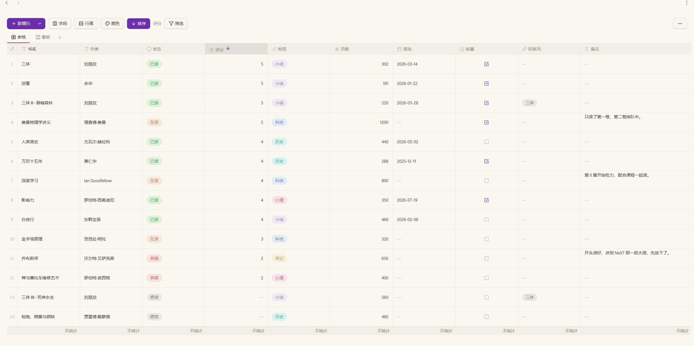
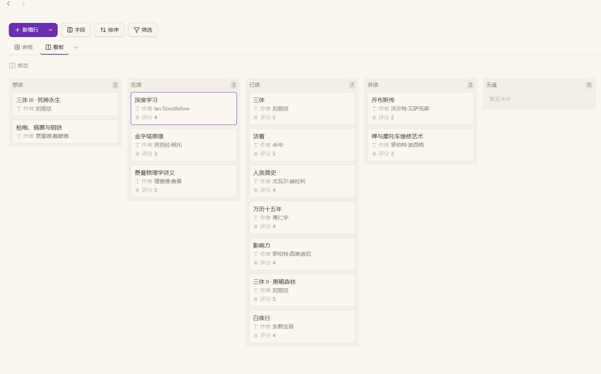

<p align="center">
  
</p>

> ### 🚨 Much of this plugin's code is AI-generated
>
> **It was written under human direction, with heavy AI assistance.**
> If you would rather not use AI-generated code, please stop using the plugin and
> uninstall it.
> It is provided as-is, without warranty of any kind.

**English** | [简体中文](README.zh.md)

# Layer Base

Multi-dimensional boards for Obsidian. A `.layer` file is a self-contained
database — field definitions, records and several views — that renders as a
table or a board, independent of your vault's folder structure.

## A look at it

The list below is `examples/读书清单.layer` from this repository: download it, put
it anywhere in your vault, and open it.

**Table view** — colour-coded selects, tags, links to other rows, and column
footers that total nothing until you ask.



**Board view** — the same rows grouped by any column, cards dragged between
columns.



## What it does

- **Table view** — edit in place, paste from a spreadsheet, drag columns,
  resize rows and columns, filter and sort.
- **Board view** — group by any column, drag cards between columns, choose
  which columns a card shows, several boards per file.
- **16 column types** — text, long text, number, date, date and time, relation,
  lookup, backlinks, auto number, rollup, formula, select, multi-select,
  checkbox, note, note property.
- **Formulas read computed columns** — a formula naming a relation column gets the
  names of the linked rows, and one naming a lookup, rollup, backlink or note
  property gets what the cell shows. A number column hands the formula its number,
  not the text it is dressed in on screen.
- **Columns read computed columns** — a relation showing a column the other table
  computes (formula, rollup, lookup, backlinks, numbering, note property) shows what
  that cell reads as, and so does a lookup, a backlink title and a rollup gathering
  it. One answer, asked of the table the column belongs to.
- **Required columns** — a column you fill in yourself can be marked required; a
  column the table computes (formula, rollup, lookup, backlinks, note property,
  numbering) is not offered that option.
- **Column totals** — an opt-in footer per column: filled, empty, unique,
  sum, average, min, max, or a date range.
- **Undo and redo** — for everything that changes data. View settings
  (column widths, filters, sorts, totals, hidden columns) are deliberately
  outside the undo stack.
- **Notes** — a `note` column links a row to a note, creating it when missing;
  a `note property` column reads and writes one key of that note's frontmatter.
- **AI access** — an optional MCP server lets an assistant edit tables through
  structured tool calls. See [AI access](#ai-access-mcp) below.

## Install

**Needs Obsidian 1.13.0 or newer.** Works on desktop and mobile.

Get the files from the **Releases** page — there is nothing to compile.

1. Download `main.js`, `manifest.json` and `styles.css` from the latest release,
   or the `.zip`, which holds exactly those three.
2. Put them in `<Vault>/.obsidian/plugins/obsidian-layer-base/` (create the
   folder if it is not there).
3. Restart Obsidian, then enable **Layer Base** under
   **Settings → Community plugins**.

Updating is the same steps with the newer files.

**With BRAT** — install [BRAT](https://github.com/TfTHacker/obsidian42-brat),
then run **BRAT → Add beta plugin** and enter
`CryingObsidian-CO/obsidian-layer-base`. BRAT also picks up each later release.

**Back up your vault before the first use.** A `.layer` file is plain JSON, so a
backup is just a copy of it.

Want the AI access as well? Also download `mcp-server.cjs` from the same
release — see [AI access](#ai-access-mcp).

## Using it

Create a board from the ribbon icon, the command palette, or by right-clicking
a folder in the file explorer (**New board**).

- **Fields** — the **Fields** button in the toolbar decides what a view shows.
  On a table it hides and shows columns; on a board it sets the grouping column,
  the card title and the columns a card lists.
- **Column totals** — click a column's footer to pick what it reports. Nothing
  is totalled until you ask.
- **Numbering** — an auto number column counts "which one of its group this is",
  and nothing is written to the file: adding, removing or regrouping rows shifts
  the numbers after them. It is a position, not a permanent id — build a fixed id
  with a formula if you need one. A formula reads the padded text the cell shows
  (`{Module} + "-" + {No}` gives `MOD-01`); write `{No} * 1` when you mean
  arithmetic.
- **Undo** — `Ctrl/Cmd+Z`, `Ctrl/Cmd+Shift+Z`, `Ctrl/Cmd+Y`, but only inside a
  table or board. They are bound by the view itself rather than as global
  hotkeys, so they never interfere with the editor. The commands appear in the
  palette, which means **Settings → Hotkeys** lists them as unassigned — that is
  expected, not a fault.

## File format

A `.layer` file is plain JSON: it stays readable, diffable and editable by hand,
and works with Obsidian Sync and file history.

```jsonc
{
  "version": 1,
  "name": "Project board",
  "fields": [
    { "id": "f_a", "name": "Title", "type": "text", "primary": true },
    { "id": "f_b", "name": "Status", "type": "select",
      "options": [{ "id": "o_1", "name": "Todo", "color": "default" }] }
  ],
  "records": [
    { "id": "r_1", "created": "2026-01-01T00:00:00.000Z",
      "cells": { "f_a": "Write the spec", "f_b": "o_1" } }
  ],
  "views": [
    { "id": "v_1", "name": "Table", "type": "grid" },
    { "id": "v_2", "name": "Board", "type": "kanban", "groupByFieldId": "f_b" }
  ]
}
```

Six rules keep the data safe across edits:

- `cells` is keyed by **field id**, so renaming a column never orphans values.
- `select` cells store **option ids**, so renaming an option never orphans values.
- The order of a column's `options` **is** that column's order: a board draws its
  columns in it and a choice column sorts by it, so reordering options moves
  nothing but positions — no cell changes.
- A computed column (formula, rollup, lookup, backlinks, note property) stores
  nothing.
- A `note property` value lives in that note's frontmatter, not in the `.layer`.
- A file written by a **newer** build is not opened: its `version` is above the one
  this build knows, so reading it would drop whatever the newer format added and the
  next save would write that loss back. Update the plugin to open it.

## AI access (MCP)

`mcp-server.cjs` is a [Model Context Protocol](https://modelcontextprotocol.io)
server that lets an assistant edit tables through structured calls instead of
hand-writing JSON. It runs as its own Node process over stdio, so **Obsidian
does not need to be running** — the app reloads the file when it changes.

It is deliberately not built into the plugin: hosting a server inside Obsidian
would need a listening port and would force the plugin to become desktop-only.

You need **Node 18 or newer** on the machine that runs the assistant.

### 1. Get the file

Download `mcp-server.cjs` from the same release and put it anywhere stable, for
example next to the plugin:

```
<Vault>/.obsidian/plugins/obsidian-layer-base/mcp-server.cjs
```

### 2. Point your client at it

Any MCP client reads a server list shaped like this:

```json
{
  "mcpServers": {
    "layer-base": {
      "command": "node",
      "args": [
        "C:/Vault/.obsidian/plugins/obsidian-layer-base/mcp-server.cjs"
      ],
      "env": {
        "LAYER_VAULT": "C:/Vault"
      }
    }
  }
}
```

Two paths, both absolute:

| Field         | Meaning                                               |
|---------------|-------------------------------------------------------|
| `args[0]`     | Where `mcp-server.cjs` sits                           |
| `LAYER_VAULT` | The vault root — the only folder the server may touch |

Forward slashes work on every platform, Windows included. If you paste a Windows
path with backslashes, double each one in JSON (`C:\\Vault`).

**Claude Desktop and similar** — paste the block into the client's config file
(`claude_desktop_config.json` for Claude Desktop) and restart it.

**DeepSeek Harness** — the same fields in the connector dialog:

- Name: `Layer Base`
- Transport: `stdio`
- Command: `node`
- Args: `["<vault>/.obsidian/plugins/obsidian-layer-base/mcp-server.cjs"]`
- Env: `{"LAYER_VAULT":"<vault>"}`

### 3. Use it

> "In `Projects/tasks.layer`, mark every row whose Status is Todo as Done."

The assistant reads first (`list_tables` → `read_table`), then writes
(`update_cells`). Nothing is written silently: a value a column cannot hold comes
back in `refused`.

### Tools

| Tool             | What it does                                                                                                                                                                                                                                           |
|------------------|--------------------------------------------------------------------------------------------------------------------------------------------------------------------------------------------------------------------------------------------------------|
| `list_tables`    | Every `.layer` in the vault, plus the vault root the paths are relative to                                                                                                                                                                             |
| `create_table`   | Create an empty `.layer` file; an existing file is never overwritten                                                                                                                                                                                   |
| `read_table`     | Columns, views (with each view's filter, sorts, hidden columns) and rows                                                                                                                                                                               |
| `add_records`    | Append rows, keyed by column name                                                                                                                                                                                                                      |
| `update_cells`   | Set single cells by row id                                                                                                                                                                                                                             |
| `delete_records` | Remove rows by id                                                                                                                                                                                                                                      |
| `add_field`      | Add a column. Options for select types; a relation needs the column it shows, a formula its expression, a rollup what to gather, a lookup the link it reads through and the column over there, a numbering column its digits and what it counts within |
| `update_field`   | Change a column: name, type, required, number format and bounds, choice options (add, remove, rename, recolour, reorder), a relation's target, a formula, a rollup, a lookup, a numbering column's digits and grouping, a note property's key          |
| `delete_field`   | Remove a column and its values                                                                                                                                                                                                                         |
| `add_view`       | Add a board view                                                                                                                                                                                                                                       |
| `update_view`    | Change a view's name, filter, sorts, hidden columns; a board's grouping, card columns and limit; a table's row height, wrapping, footers, colour rules and column widths                                                                               |
| `delete_view`    | Remove a board view (the table view cannot be removed)                                                                                                                                                                                                 |

### Two things to know

- **Paths are relative to `LAYER_VAULT`.** `list_tables` names the root and
  returns paths you can pass back unchanged. A path outside the vault is
  refused.
- **A view is named, never "the one on screen".** The file does not record which
  view is open and the server cannot see Obsidian, so pass the view's name or
  id. Read the views with `read_table` first.
- **A cell is emptied by writing `""`.** Every column type, including number and
  date, whose own parser has no empty value — the clear is what the app does when
  a cell is emptied.
- **A computed column's value cannot be read from here.** Numbering is the
  exception, because a row's position can be counted on either side. Every other
  computed column carries an `unreadable` note with a `tellUser` sentence: it is
  the assistant's job to pass that on rather than report the column as empty.

Values are text as a person would type them — a number is `"42"`, a checkbox is
`"true"`, a date is `"2026-01-31"`, a select is the option **name**, a
multi-select is `"Red, Blue"`. The column's own parser decides, and every save
goes through the same parse and serialize the plugin uses, so a file stays valid
whatever a caller asks for.

Numbering is the exception: the plugin counts it from the row order, `read_table`
reports it, and a write to it is refused — it is not a stored value.

### If something goes wrong

| Symptom                             | Cause                                                          |
|-------------------------------------|----------------------------------------------------------------|
| `No table at "..."`                 | The path is not relative to the vault root — run `list_tables` |
| `Outside the vault`                 | The path escapes `LAYER_VAULT`                                 |
| The client lists no tools           | `node` is not on `PATH`, or `args[0]` is wrong                 |
| Changes are not visible in Obsidian | The table is open with unsaved state; reopen it                |

## Known limitations

- A board shows a note property but cannot edit it; editing is a table action.
- A numbering column is counted from the row order: adding, removing or regrouping
  rows shifts the numbers after them. It is a position, not a permanent id.
- Filtering or sorting a formula column recomputes the formula for each
  comparison, which is noticeable on very large tables.
- A note property is read when the view opens. Changes made to that note
  elsewhere show up after the table is reopened.

## Languages

The interface follows the Obsidian app language, shipping English, Simplified
Chinese and Traditional Chinese.

## Privacy

No network requests and no telemetry. The plugin reads and writes only the
`.layer` files you open, plus the frontmatter of notes you link to with a
`note property` column. The MCP server touches nothing outside `LAYER_VAULT`.

## License

GNU General Public License v3.0 — Copyright (C) 2026 CryingObsidian-CO.

You may use, modify and redistribute this plugin under the terms of the
GPL-3.0. A modified version you distribute must carry the same licence, with its
source available. The full text is in [LICENSE](LICENSE).

This program is distributed in the hope that it will be useful, but WITHOUT ANY
WARRANTY; without even the implied warranty of MERCHANTABILITY or FITNESS FOR A
PARTICULAR PURPOSE. See the GNU General Public License for more details.

## Building from source

Only needed if you want to change the plugin. Released builds are attached to
the Releases page and need none of this.

```bash
npm install
npm run dev        # watch build to main.js
npm run build      # type check + production build
npm run build:mcp  # bundle the MCP server
npm test           # unit tests
npm run lint
npm run check:i18n
npm run verify:css
```

Strings live in one typed catalogue (`src/i18n`); every key must appear exactly
once per language, which `npm run check:i18n` enforces. Developer-facing output
(console messages, parser warnings) stays in English on purpose.

## References

- [Obsidian sample plugin](https://github.com/obsidianmd/obsidian-sample-plugin)
- [API documentation](https://docs.obsidian.md)
