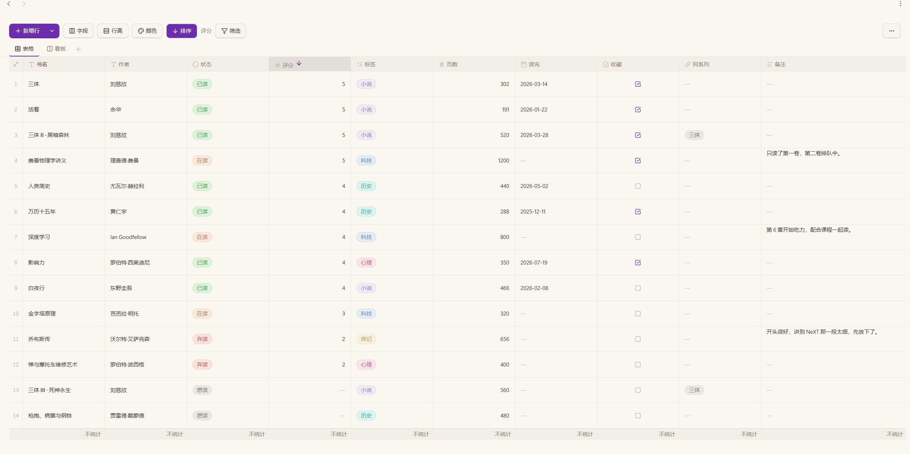
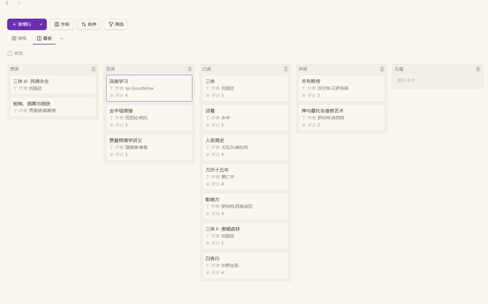

<p align="center">
  
</p>

> ### 🚨 本插件的大量代码由 AI 生成
>
> **本插件在人工指导下、由 AI 大量辅助编写。**
> 如果你介意任何形式的 AI 生成内容，请停止使用并卸载本插件。
> 本插件按「现状」提供，不附带任何形式的担保。

[English](README.md) | **简体中文**

# Layer Base 多维看板

Obsidian 的多维看板插件。一个 `.layer` 文件就是一份自包含的数据库——字段定义、
记录和多个视图——既可以当表格用，也可以当看板用，与仓库的目录结构无关。

## 看一眼

**表格视图** — 彩色单选、多选标签、指向同一文件内其它行的关联，列脚默认什么也不统计。



**看板视图** — 同一批行按任意一列分组，卡片可以直接拖动换列。



## 能做什么

- **表格视图** — 就地编辑、从电子表格粘贴、拖动列、调整行高列宽、筛选排序。
- **看板视图** — 任意列分组、拖动卡片换列、选卡片显示哪些列、一个文件可放多个看板。
- **16 种字段类型** — 文本、长文本、数字、日期、日期时间、关联、查找、反向关联、
  自增编号、汇总、公式、单选、多选、勾选、笔记、笔记属性。
- **公式能读派生列** — 公式里引用关联列，拿到的是对方行的名字；引用查找、汇总、
  反向关联、笔记属性，拿到的是表格上显示的那个值。数字列交给公式的是数字本身，
  不是屏幕上那层打扮。
- **列也能读别的列** —
  关联列如果显示的是对方表算出来的列（公式、汇总、查找、反向关联、自增编号、笔记属性），格子里就是那一格读出来的值；查找、反向关联的标题、汇总取数也一样。一个答案，去问那一列所在的表。
- **必填** — 可以给「你自己填」的列设必填；由表格算出来的列（公式、汇总、查找、
  反向关联、笔记属性、自增编号）不提供这个选项。
- **列合计** — 每列可单独开启的列脚：已填写、未填写、唯一值、求和、平均值、最小值、
  最大值、日期范围。
- **撤销与重做** — 覆盖所有改数据的操作。视图设置（列宽、筛选、排序、合计、隐藏列）
  刻意不进撤销栈。
- **笔记联动** — `note` 列把一行关联到某个笔记，笔记不存在时会自动创建；
  `note property` 列读写那篇笔记 frontmatter 里的一个键。
- **AI 接入** — 可选的 MCP 服务器，让 AI 通过结构化调用编辑表格。见下文
  [AI 接入](#ai-接入mcp)。

## 安装

**需要 Obsidian 1.13.0 或更新版本。** 桌面端和移动端都能用。

**从商店装** — 打开 **设置 → 第三方插件 → 浏览**，搜索 **Layer Base**，然后
**安装** 再 **启用**。升级也走同一个入口。

**手动装** — 到
[Releases](https://github.com/CryingObsidian-CO/obsidian-layer-base/releases) 页面下载，
不需要编译任何东西。

1. 在最新版本里下载 `main.js`、`manifest.json`、`styles.css`；也可以直接下
   `.zip`，里面就是这三个文件。
2. 放进 `<仓库>/.obsidian/plugins/layer-base/`（目录不存在就新建）。
3. 重启 Obsidian，然后在 **设置 → 第三方插件** 里启用 **Layer Base**。

手动装的话，升级也是同样三步，换成新版本的文件即可。

**用 BRAT**（能随后续版本自动更新）：装上
[BRAT](https://github.com/TfTHacker/obsidian42-brat)，在 **BRAT → Add beta
plugin** 里填 `CryingObsidian-CO/obsidian-layer-base`。

**第一次使用前请先备份你的仓库。** `.layer` 就是纯 JSON 文件，备份等于复制一份。

还需要 AI 接入的话，在同一次发布里把 `mcp-server.cjs` 也下载下来——
见下文 [AI 接入](#ai-接入mcp)。

## 怎么用

新建方式：功能区图标、命令面板，或在左侧文件列表里右键文件夹 → **新建多维看板**。

- **字段** — 工具栏的 **字段** 按钮决定这个视图显示什么。表格里是隐藏/显示列；
  看板里是分组列、卡片标题、卡片列出的那几列。
- **列合计** — 点某一列的列脚，选它统计什么。你不选，它就什么也不统计。
- **编号** — 自增编号是「在本组里排第几个」，不存进文件：增删行、改分组，后面的号
  都会跟着前移。它表示位置，不适合当永久编号；需要固定编号时，用公式自己拼一列。
  公式里读到的是屏幕上那个补零后的文本（`{模块} + "-" + {编号}` 得到 `MOD-01`），
  要算数请写 `{编号} * 1`。
- **撤销** — `Ctrl/Cmd+Z`、`Ctrl/Cmd+Shift+Z`、`Ctrl/Cmd+Y`，仅在表格或看板内生效。
  这些键绑在**视图自己**身上、不是全局热键，所以不会干扰编辑器。命令面板里仍有对应
  条目，因此 **设置 → 快捷键** 会把它们显示为**未分配**——这是预期现象，不是故障。

## 文件格式

`.layer` 就是磁盘上的纯 JSON：可读、可 diff、可手改，也能正常配合 Obsidian Sync
与文件历史。

```jsonc
{
  "version": 1,
  "name": "项目看板",
  "fields": [
    { "id": "f_a", "name": "标题", "type": "text", "primary": true },
    { "id": "f_b", "name": "状态", "type": "select",
      "options": [{ "id": "o_1", "name": "待办", "color": "default" }] }
  ],
  "records": [
    { "id": "r_1", "created": "2026-01-01T00:00:00.000Z",
      "cells": { "f_a": "写方案", "f_b": "o_1" } }
  ],
  "views": [
    { "id": "v_1", "name": "表格", "type": "grid" },
    { "id": "v_2", "name": "看板", "type": "kanban", "groupByFieldId": "f_b" }
  ]
}
```

六条规则保证了改来改去也不会丢数据：

- `cells` 按**字段 id** 存，改列名不会让值失去归属。
- `select` 存的是**选项 id**，改选项名或换颜色都不会让值失去归属。
- `options` 的**顺序**就是这个字段的顺序：看板照它排列列，单选/多选列也照它排序。
  所以调整顺序只是换数组里的位置，一个格子都不用动。
- 派生列（公式、汇总、查找、反向关联、笔记属性）**不存任何值**。
- `note property` 的值存在那篇笔记的 frontmatter 里，不在 `.layer` 里。
- **更新版本**写出的文件不会打开：它的 `version` 高于本插件认得的版本，读进来就会把新
  格式加的东西丢掉，而下次保存又把这个"丢掉"写回去。升级插件再打开它。

## AI 接入（MCP）

`mcp-server.cjs` 是一个 [Model Context Protocol](https://modelcontextprotocol.io)
服务器，让 AI 通过**结构化调用**改表格，而不是手写 JSON。它是独立的 Node 进程，
走 stdio，所以**不需要 Obsidian 开着**——文件变了 Obsidian 会自己重载。

它刻意**没有**做成插件内置。

运行 AI 的那台机器上需要 **Node 18 或更新版本**。

### 1. 拿到文件

在同一次发布里下载 `mcp-server.cjs`，放在一个稳定的位置，比如插件旁边：

```
<仓库>/.obsidian/plugins/layer-base/mcp-server.cjs
```

### 2. 让客户端指向它

任何 MCP 客户端都可以使用下面这种配置：

```json
{
  "mcpServers": {
    "layer-base": {
      "command": "node",
      "args": [
        "C:/Vault/.obsidian/plugins/layer-base/mcp-server.cjs"
      ],
      "env": {
        "LAYER_VAULT": "C:/Vault"
      }
    }
  }
}
```

两个路径都写**绝对路径**：

| 字段            | 含义                   |
|---------------|----------------------|
| `args[0]`     | `mcp-server.cjs` 的位置 |
| `LAYER_VAULT` | 仓库根目录——服务器唯一允许碰的文件夹  |

正斜杠在所有平台都能用，Windows 也一样。如果你要粘带反斜杠的 Windows 路径，
JSON 里每个反斜杠都要写成双份（`C:\\Vault`）。

**Claude Desktop 及其他客户端** — 把上面的 JSON 粘进客户端的配置文件
（Claude Desktop 是 `claude_desktop_config.json`），然后重启客户端。

**DeepSeek Harness** — 连接器对话框里填同样的几项：

- 名称：`Layer Base`
- 传输方式：`stdio`
- 命令：`node`
- 参数：`["<仓库>/.obsidian/plugins/layer-base/mcp-server.cjs"]`
- 环境变量：`{"LAYER_VAULT":"<仓库>"}`

### 3. 使用

> 「在 `项目/任务.layer` 里，把所有状态为待办的行改成完成。」

助手先读（`list_tables` → `read_table`）再写（`update_cells`）。**不会静默写入**：
列装不下的值会出现在 `refused` 里。

### 工具清单

| 工具               | 作用                                                                               |
|------------------|----------------------------------------------------------------------------------|
| `list_tables`    | 列出仓库里所有 `.layer`，并给出路径所相对的仓库根目录                                                  |
| `create_table`   | 新建一个空 `.layer` 文件；已存在则拒绝，绝不覆盖                                                    |
| `read_table`     | 读列、视图（含每个视图的筛选、排序、隐藏列）和行                                                         |
| `add_records`    | 按列名追加行                                                                           |
| `update_cells`   | 按行 id 改单个单元格                                                                     |
| `delete_records` | 按 id 删行                                                                          |
| `add_field`      | 加列。单选类可一并给选项；关联列要说明显示目标表哪一列，公式列要给表达式，汇总列要说明汇总什么，查找列要说明沿哪条关联、取对方表哪一列，自增编号可给位数与分组列 |
| `update_field`   | 改列：名字、类型、必填、数字格式与值域、选项增删改名换色与排序、关联指向、公式、汇总、查找、编号位数与分组、笔记属性的键                     |
| `delete_field`   | 删列及其值                                                                            |
| `add_view`       | 加看板视图                                                                            |
| `update_view`    | 改视图的名字、筛选、排序、隐藏列；看板另可改分组列、卡片列、列数上限；表格另可改行高、自动换行、列脚统计、颜色规则、列宽                     |
| `delete_view`    | 删看板视图（表格视图不可删）                                                                   |

### 需要知道的几点

- **路径相对 `LAYER_VAULT`。** `list_tables` 会把根目录一并返回，并给出可直接回传的
  路径。越界路径会被拒绝。
- **改列用 `update_field`，不要删了重建。** 名字、类型、必填、数字格式与值域、选项的增删
  改名换色与排序、关联指向、公式、汇总、查找、编号位数与分组、笔记属性的键，都能改；只改你
  传的那几项，所以改一列不会丢这一列的值。改类型会清空这一列，返回里会说明清掉了几格。
- **清空格子写 `""`。** 任何类型都行，包括数字和日期（它们自己的解析器没有「空值」这一说）；
  这就是在 app 里清空格子做的事。
- **计算列会读回屏幕上显示的值。** 自增编号也在这里算出来。每一列会说明自己
  `readable`、`writable` 与否，有边界时带 `readLimit`/`writeLimit`。汇总、查找或关联如果读到
  另一张表的计算列，会带一条 `computedFrom`，写明那张表和列；这个值是算出来的、不存
  在本表，所以不能从这里写回去。笔记属性只读顶层 frontmatter 值；嵌套映射读成空，
  并在那一行的 `notes` 里点名。
- **读取之后文件又被改过，这一写会被拒绝。** 服务器在真正写入前会重读文件；如果中间
  Obsidian、同步客户端或另一个助手保存过，它就什么都不写并让调用失败。重新读一次表，
  再改一遍。
- **打开着的表会跟着文件刷新。** 别的程序写入后，打开着的视图会重新读这份文件；如果
  视图里还有未保存的改动，你那一版会另存为冲突副本，提示里会写出路径。
- **视图必须按名字指定，没有「屏幕上那个」。** 文件里不记录哪个视图正开着，服务器也
  看不到 Obsidian，所以要传视图名或 id。先用 `read_table` 把视图读出来。

值是「人怎么打字就怎么写」的文本——数字写 `"42"`、勾选写 `"true"`、日期写
`"2026-01-31"`、单选写选项**名**、多选写 `"红, 蓝"`。由列类型自己解析；每次保存都走
插件同一套解析与序列化，所以无论调用方要什么，文件都始终合法。

自增编号是例外：它由插件按文件里的行序算出来，`read_table` 会把它读出来，但写入时
会被拒绝——它不是存储值。

### 出问题时

| 现象                  | 原因                                |
|---------------------|-----------------------------------|
| `No table at "..."` | 路径不是相对仓库根目录——先跑 `list_tables`     |
| `Outside the vault` | 路径跑出了 `LAYER_VAULT`               |
| 客户端看不到任何工具          | `node` 不在 `PATH`，或 `args[0]` 路径不对 |
| Obsidian 里看不到改动     | 表格开着且有未保存改动时文件被外部修改；你的版本已另存为冲突副本，按提示里的路径找 |

## 已知限制

- 看板能显示笔记属性，但不能编辑；编辑是表格里的操作。
- 自增编号按行序算：增删行或改分组，后面的编号会前移。它表示位置，不是永久编号。
- 对公式列做筛选或排序，每次比较都会重算公式，大表上会有可感知的延迟。
- 笔记属性在视图打开时读一次。在别处改了那篇笔记，要重新打开表格才看得到。

## 遇到问题

| 现象 | 先看这里 |
| --- | --- |
| 商店列表里找不到这个插件 | Obsidian 版本低于 1.13.0 |
| 打开文件时提示「由更新的版本写入」 | 更新插件。文件的 `version` 高于这个构建能读的范围，硬读会丢掉新格式带来的东西，再一保存就把损失写回去 |
| 某一行在看板上不出现 | 它的分组列是空的，而空值本身不成一列；给它一个值 |
| 删掉一行后，自增编号的数字变了 | 编号是位置，不是存下来的 id；增删行或改分组，后面的号会跟着前移 |
| 按 `Ctrl/Cmd+Z` 没反应 | 撤销只在表格和看板内部绑定，编辑器不受影响 |

## 多语言

界面跟随 Obsidian 的语言，内置英文、简体中文、繁体中文。

## 隐私

不发起网络请求，也不收集任何遥测。插件只读写你打开的 `.layer` 文件，以及你用
`note property` 列关联到的那些笔记的 frontmatter。MCP 服务器不碰 `LAYER_VAULT`
以外的任何东西。

## 问题、Bug 和功能建议

都欢迎，中文英文都可以。统一走
[Issues](https://github.com/CryingObsidian-CO/obsidian-layer-base/issues)，里面有一个
bug 模板和一个功能模板。

**报 bug 时**，这些最有帮助：

- 你点了什么、实际发生了什么。「看板坏了」没法查；「我把卡片拖进空列，它又弹回去了」可以查。
- Obsidian 版本，以及 **设置 → 第三方插件** 里看到的插件版本。
- 桌面端、移动端，还是两边都有。
- 开发者控制台（`Ctrl/Cmd+Shift+I`）里的报错。它往往比描述更快指出原因。
- 如果只和某一张表有关，附一份精简过的 `.layer`；不想公开的值替换掉就行，要紧的是结构。

**提功能建议时**，说清场景，不要把按钮描绘出来：你想做成什么事，现在卡在哪一步。拿你自己
的表举一个例子，比一份规格说明管用。

这个项目是一位维护者在做，代码大量由 AI 辅助写成。每个报告都会看；不是每个都会有回复，
也不会承诺时间。**没有回复不等于拒绝。**

**不想写东西的话**：给仓库点个 star，这个项目要的支持就这么多。

## 参与开发

[CONTRIBUTING.md](CONTRIBUTING.md) 里写了分支模型、门禁和发版步骤。简单说：改动进
`develop`，值得单独审阅的才开分支，PR 合并前 `npm run verify` 要通过。

## 许可证

GNU General Public License v3.0 —— 版权所有 (C) 2026 CryingObsidian-CO。

你可以依据 GPL-3.0 的条款使用、修改与再分发本插件。若你分发修改后的版本，它必须
以同一许可证发布，并提供源码。完整条文见 [LICENSE](LICENSE)。

本程序分发时希望它有用，但不提供任何担保；甚至不保证适销性或适用于某一特定用途。
详见 GNU 通用公共许可证。

## 从源码构建

只有想改插件的人需要这一段。正式版本直接挂在 Releases 页面，不需要任何构建。

```bash
npm install
npm run dev        # 监视构建 main.js
npm run build      # 类型检查 + 生产构建
npm run build:mcp  # 打包 MCP 服务器
npm test           # 单元测试
npm run lint
npm run check:i18n
npm run verify:css
```

文案集中在一个带类型的目录（`src/i18n`），每个键在每种语言里必须恰好出现一次，
由 `npm run check:i18n` 强制检查。面向开发者的输出（console、解析警告）保持英文。

## 参考

- [Obsidian 示例插件](https://github.com/obsidianmd/obsidian-sample-plugin)
- [API 文档](https://docs.obsidian.md)
